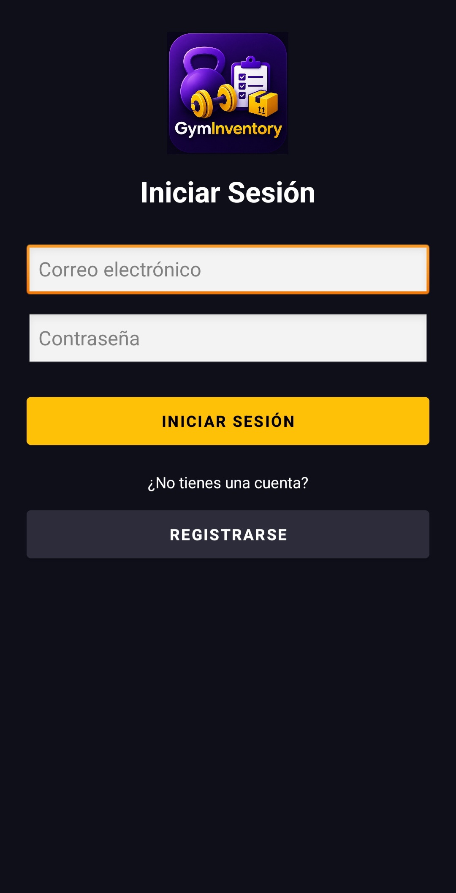
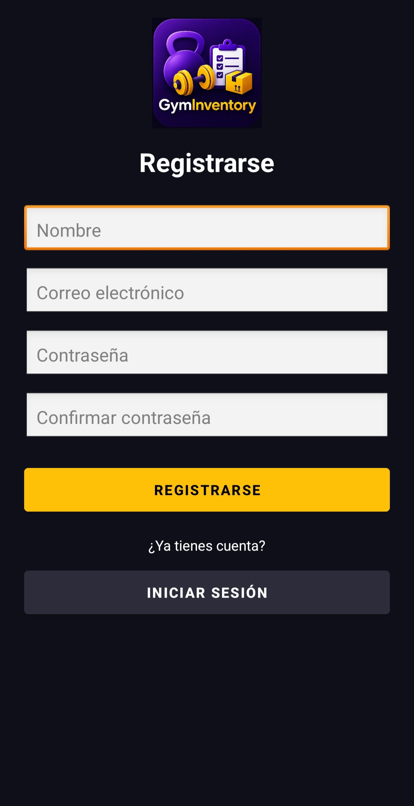
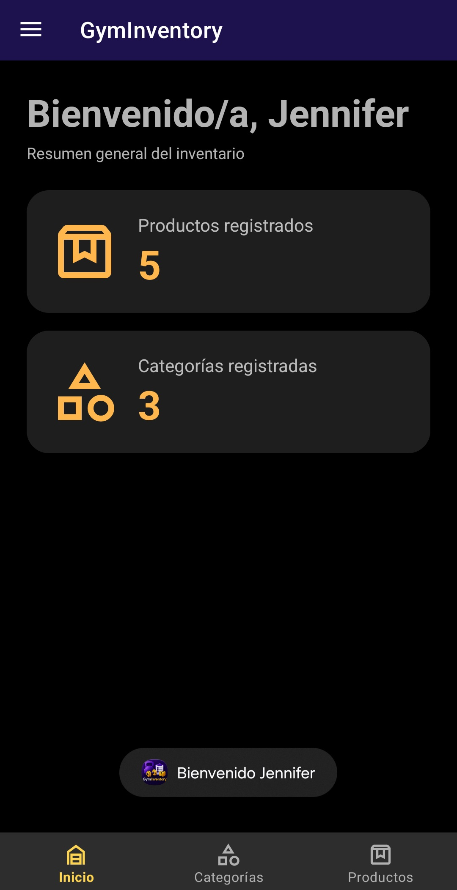
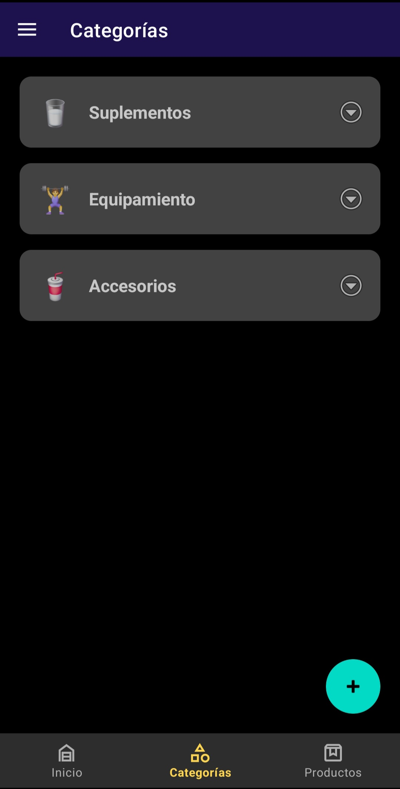
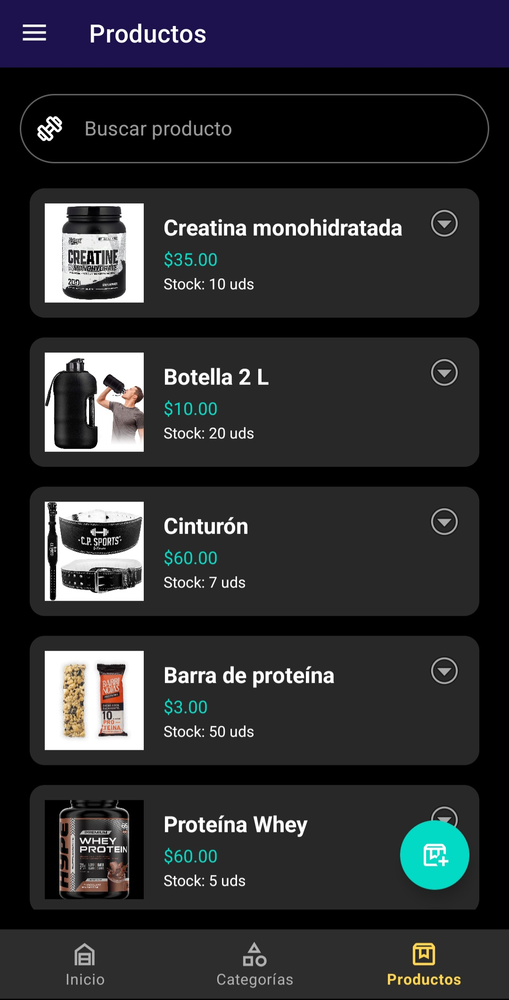
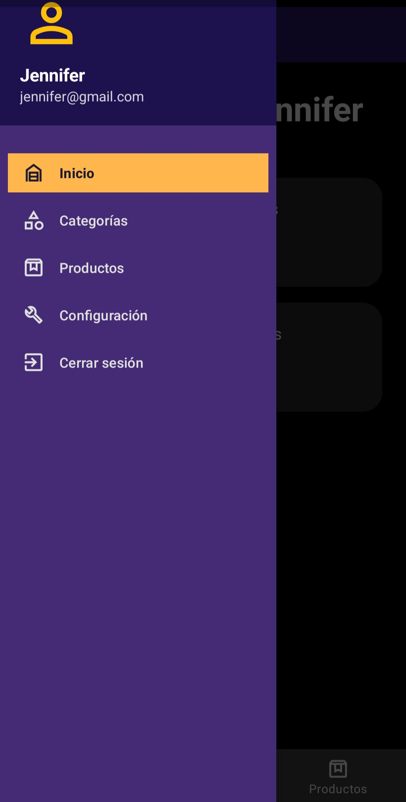
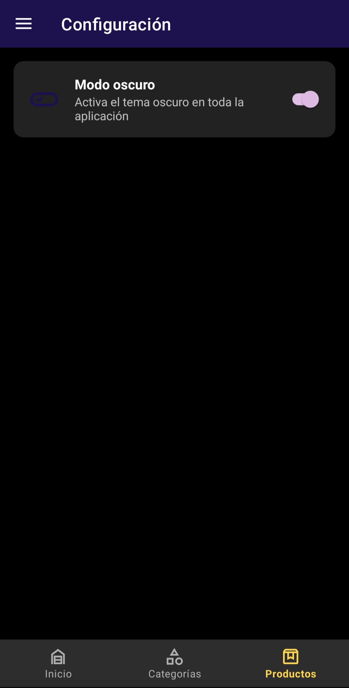

# GymInventory - Gestión de Inventario para Gimnasios

**GymInventory** es una aplicación móvil nativa para Android, desarrollada en Java. Está diseñada específicamente para facilitar la administración del inventario de un gimnasio, permitiendo un control rápido y eficiente sobre las categorías y los productos disponibles.

## Funcionalidades Principales

La aplicación cuenta con las siguientes características:

### Autenticación de Usuarios
* **Registro:** Creación de nuevas cuentas de usuario para poder utilizar el sistema.
* **Inicio de sesión:** Acceso seguro para gestionar la información.
* **Cierre de sesión:** Opción disponible de forma accesible desde el menú principal.

### Gestión de Inventario
* **Categorías:** Creación, lectura, actualización y eliminación de categorías para organizar el inventario del gimnasio.
* **Productos:** Control total sobre los artículos del gimnasio (suplementos, equipo, bebidas, etc.) asociados a sus respectivas categorías.

### Navegación Intuitiva
* **Menú Lateral (Side Navigation Drawer):** Acceso completo a todas las secciones de la app, que incluye un encabezado personalizado con los datos del usuario:
    * Inicio
    * Categorías
    * Productos
    * Configuración (Modo Día/Noche)
    * Cerrar sesión
* **Barra de Navegación Inferior (Bottom Navigation):** Accesos directos para mayor agilidad a las secciones más utilizadas: **Inicio**, **Categorías** y **Productos**.

### Personalización
* **Modo Oscuro / Claro:** La aplicación soporta el cambio entre modo día y noche desde el menú de Configuración, adaptando los colores de la interfaz.

## Stack Tecnológico

El proyecto está construido bajo los siguientes estándares y herramientas:

* **Plataforma:** Android (Min SDK 30, Target SDK 36)
* **Lenguaje:** Java 11
* **Base de Datos Local:** Room Database (v2.8.4)
* **Arquitectura UI y Vistas:**
    * ViewBinding habilitado.
    * RecyclerView para listados dinámicos.
    * Vistas estándar de Android mediante XML (`LinearLayout`, `ImageView`, `TextView`).
* **Navegación:** Android Navigation Component (`navigation-fragment-ktx`, `navigation-ui-ktx`).

## Capturas de Pantalla

| Inicio de Sesión | Registro | Pantalla de Inicio |
| :---: | :---: | :---: |
|  |  |  |

| Categorías | Productos | Menú Lateral (Sidenav) |
| :---: | :---: | :---: |
|  |  |  |

| Modo Oscuro / Configuración |
| :---: |
|  |

## Instalación y Configuración Local

Sigue estos pasos para ejecutar el proyecto en tu entorno local usando Android Studio.

### Prerrequisitos
* Tener instalado **Android Studio** (versión más reciente recomendada).
* Emulador o dispositivo físico con **Android 11 (API 30)** o superior.

### Pasos
1. **Clonar el repositorio:**
   ```bash
   git clone https://github.com/mg23117/GymInventory.git
   ```
2. **Abrir el proyecto:**
    * Abre Android Studio.
    * Selecciona `File` > `Open` y busca la carpeta `GymInventory`.
3. **Sincronizar Gradle:**
    * Espera a que Android Studio descargue dependencias (como Room o Navigation Component) y sincronice el proyecto.
4. **Ejecutar la aplicación:**
    * Conecta tu dispositivo Android o inicia el emulador.
    * Haz clic en **Run** en la barra superior.
